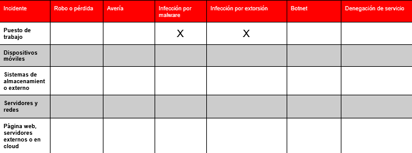
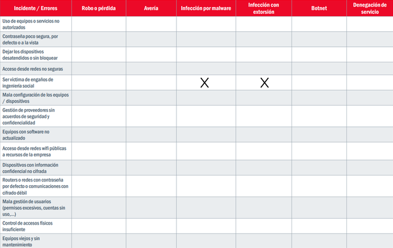

# IS-1.1-G1
Alejandro, Raúl, Luis y Hugo.

#### 1. ¿Qué ha ocurrido?

Se ha recibido un correo electrónico de un cliente antiguo en el que había un archivo vacío. Por lo tanto, fue reenviado a otros compañeros para ver si se trataba de un error puntual de software. Al rato, apareció un mensaje en pantalla en todos los ordenadores que abrieron dicho correo. Los ordenadores estaban cifrados desde ese momento y el mensaje solicitaba dinero a cambio de desbloquearlos.

#### 2. ¿Dónde se ha originado? ¿Qué dispositivos están afectados?

Se ha originado en el PC del primer comercial que accedió a dicho correo, infectando luego los ordenadores de todos los trabajadores a los que fue reenviado.

#### 3. ¿Cuándo o desde cuándo ocurre?

Desde que se abrió el primer correo, un lunes a última hora.

#### 4. ¿Quién ha podido hacerlo, por qué y cómo (posibles causas)?

Un cliente antiguo que ha tenido una mala experiencia, o una posible suplantación de identidad aprovechando una cuenta de cliente antigua por motivos económicos.

#### 5. ¿Cuáles son los daños materiales, personales y económicos? ¿Podemos valorarlos?

Los gastos relacionados con la discontinuidad del trabajo, como no poder tramitar pedidos, y el daño a la reputación de los trabajadores y de la empresa. Aproximadamente unos 28.000 €, según Kaspersky Lab.

#### 6. ¿Tendremos que avisar a nuestros clientes o usuarios?

Sí, ya que los clientes están llamando insistentemente. Sin embargo, si los datos de los clientes no se han visto comprometidos, no tenemos por qué especificar el motivo del incidente.

#### 7. ¿Tiene consecuencias sobre nuestra reputación?

Sí, independientemente de que se sepa que ha sido un ciberataque o simplemente se diga que es un problema técnico, debido al retraso que ya se ha generado. Todavía más si tenemos que reconocer el ataque.

#### 8. ¿Tiene implicaciones legales?
Si no se han robado los datos de los clientes, no debería tener implicaciones legales para la empresa.

----

----

----
